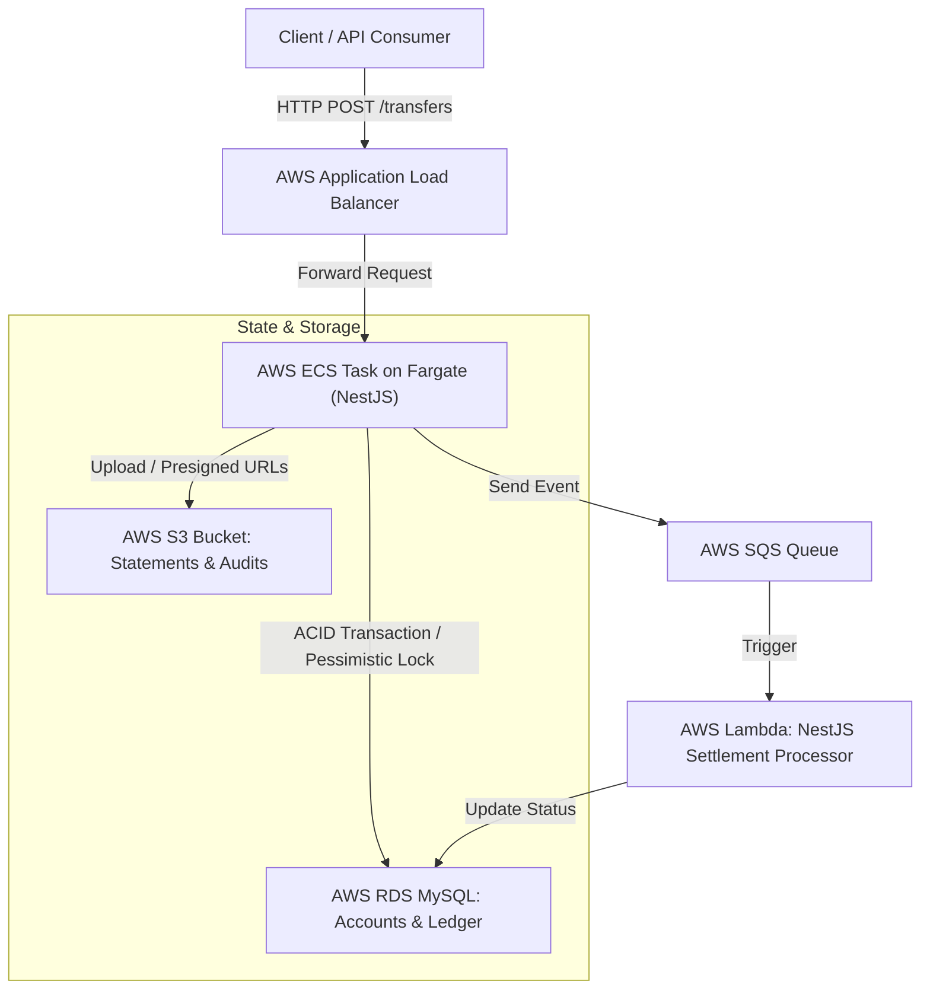
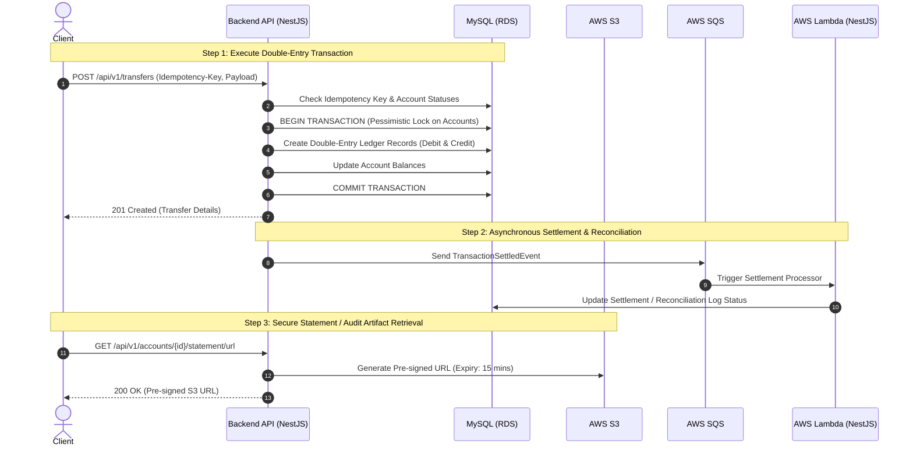

# LedgerStream (Ledger/Accounts, FinTech) Pet Project
This pet project is to demonstrate the skills of AI-assisted technical design and implementation using:
- TypeScript, NestJS, TypeORM
- MySQL
- AWS - ECS/Fargate, ALB, RDS, S3, Lambda, SQS, serverless architecture
- Terraform
- Git/GitHub

# Technical Design Document: LedgerStream (Ledger/Accounts, FinTech)

## 1. System Overview & Architecture

LedgerStream is a core financial ledger and transaction processing service designed for high reliability, strict ACID compliance, and secure cloud-native deployment on **AWS ECS with Fargate**, backed by **Amazon RDS MySQL**, **AWS S3**, and **AWS SQS/Lambda**.



## 2. Core Transaction Flow
The sequence diagram below illustrates how client requests are processed through double-entry database constraints with pessimistic locking, and emitted asynchronously for settlement.



## 3. Database Schema & Mock Data (SQL Migrations)

### 3.1 Initial Schema

```sql
CREATE TABLE accounts (
    id VARCHAR(36) PRIMARY KEY,
    account_number VARCHAR(34) NOT NULL UNIQUE,
    holder_name VARCHAR(100) NOT NULL,
    currency VARCHAR(3) NOT NULL DEFAULT 'NZD',
    balance DECIMAL(19, 4) NOT NULL DEFAULT 0.0000,
    status VARCHAR(20) NOT NULL DEFAULT 'ACTIVE',
    created_at DATETIME DEFAULT CURRENT_TIMESTAMP,
    updated_at DATETIME DEFAULT CURRENT_TIMESTAMP ON UPDATE CURRENT_TIMESTAMP
) ENGINE=InnoDB;

CREATE TABLE ledger_entries (
    id VARCHAR(36) PRIMARY KEY,
    transaction_reference VARCHAR(50) NOT NULL,
    account_id VARCHAR(36) NOT NULL,
    entry_type VARCHAR(6) NOT NULL CHECK (entry_type IN ('DEBIT', 'CREDIT')),
    amount DECIMAL(19, 4) NOT NULL,
    currency VARCHAR(3) NOT NULL DEFAULT 'NZD',
    description VARCHAR(255),
    created_at DATETIME DEFAULT CURRENT_TIMESTAMP,
    CONSTRAINT fk_ledger_account FOREIGN KEY (account_id) REFERENCES accounts(id)
) ENGINE=InnoDB;

CREATE TABLE idempotency_keys (
    idempotency_key VARCHAR(100) PRIMARY KEY,
    request_hash VARCHAR(64) NOT NULL,
    response_body TEXT,
    created_at DATETIME DEFAULT CURRENT_TIMESTAMP
) ENGINE=InnoDB;

CREATE INDEX idx_ledger_tx_ref ON ledger_entries(transaction_reference);
CREATE INDEX idx_ledger_account_id ON ledger_entries(account_id);
```

### 3.2 Sample Mock Data

```sql
INSERT INTO accounts (id, account_number, holder_name, currency, balance, status, created_at, updated_at) VALUES
('acc-001-nzd', 'NZ01-8839-0012938-00', 'Kelvin Smith', 'NZD', 15000.0000, 'ACTIVE', NOW(), NOW()),
('acc-002-nzd', 'NZ01-8839-0098412-00', 'Treasury Ops', 'NZD', 500000.0000, 'ACTIVE', NOW(), NOW()),
('acc-003-nzd', 'NZ01-8839-0044123-00', 'Jane Doe', 'NZD', 250.5000, 'ACTIVE', NOW(), NOW());

INSERT INTO ledger_entries (id, transaction_reference, account_id, entry_type, amount, currency, description, created_at) VALUES
('tx-init-001', 'TX-INIT-20261018-01', 'acc-002-nzd', 'DEBIT', 15000.0000, 'NZD', 'Initial funding for Kelvin Smith', NOW()),
('tx-init-002', 'TX-INIT-20261018-01', 'acc-001-nzd', 'CREDIT', 15000.0000, 'NZD', 'Initial account balance creation', NOW());
```

## 4. Application Implementation Details

### 4.1 Core Transfer Service (transfer.service.ts)

```typescript
import { Injectable, Logger, BadRequestException } from '@nestjs/common';
import { DataSource } from 'typeorm';
import { Account } from '../entity/account.entity';
import { LedgerEntry } from '../entity/ledger-entry.entity';
import { IdempotencyKey } from '../entity/idempotency-key.entity';
import { randomUUID } from 'crypto';

@Injectable()
export class TransferService {
  private readonly logger = new Logger(TransferService.name);

  constructor(private readonly dataSource: DataSource) {}

  async executeTransfer(
    idempotencyKeyStr: string | undefined,
    sourceAccountId: string,
    destinationAccountId: string,
    amount: string,
    currency: string,
    description: string,
  ): Promise<string> {
    this.logger.log(`Begin transfer from ${sourceAccountId} to ${destinationAccountId} of amount ${amount} ${currency}`);

    if (idempotencyKeyStr && idempotencyKeyStr.trim() !== '') {
      const existingKey = await this.dataSource.getRepository(IdempotencyKey).findOne({
        where: { idempotencyKey: idempotencyKeyStr },
      });
      if (existingKey) {
        return existingKey.responseBody;
      }
    }

    if (Number(amount) <= 0) {
      throw new BadRequestException('Transfer amount must be strictly positive');
    }

    const queryRunner = this.dataSource.createQueryRunner();
    await queryRunner.connect();
    await queryRunner.startTransaction();

    try {
      const sourceAccount = await queryRunner.manager.findOne(Account, {
        where: { id: sourceAccountId },
        lock: { mode: 'pessimistic_write' },
      });

      if (!sourceAccount) {
        throw new BadRequestException(`Source account not found: ${sourceAccountId}`);
      }

      const destAccount = await queryRunner.manager.findOne(Account, {
        where: { id: destinationAccountId },
        lock: { mode: 'pessimistic_write' },
      });

      if (!destAccount) {
        throw new BadRequestException(`Destination account not found: ${destinationAccountId}`);
      }

      if (Number(sourceAccount.balance) < Number(amount)) {
        throw new BadRequestException('Insufficient funds in source account');
      }

      const txRef = 'TX-' + randomUUID().substring(0, 8).toUpperCase();

      const debitEntry = LedgerEntry.createDebit(txRef, sourceAccountId, amount, currency, description);
      const creditEntry = LedgerEntry.createCredit(txRef, destinationAccountId, amount, currency, description);

      await queryRunner.manager.save(LedgerEntry, [debitEntry, creditEntry]);

      sourceAccount.balance = (Number(sourceAccount.balance) - Number(amount)).toFixed(4);
      destAccount.balance = (Number(destAccount.balance) + Number(amount)).toFixed(4);

      const now = new Date();
      sourceAccount.updatedAt = now;
      destAccount.updatedAt = now;

      await queryRunner.manager.save(Account, [sourceAccount, destAccount]);

      if (idempotencyKeyStr && idempotencyKeyStr.trim() !== '') {
        const keyRecord = queryRunner.manager.create(IdempotencyKey, {
          idempotencyKey: idempotencyKeyStr,
          requestHash: sourceAccountId + destinationAccountId + amount,
          responseBody: txRef,
          createdAt: new Date(),
        });
        await queryRunner.manager.save(IdempotencyKey, keyRecord);
      }

      await queryRunner.commitTransaction();

      this.logger.log(
        `End transfer from ${sourceAccountId} to ${destinationAccountId} of amount ${amount} ${currency}, transaction reference: ${txRef}`
      );

      return txRef;
    } catch (err) {
      await queryRunner.rollbackTransaction();
      throw err;
    } finally {
      await queryRunner.release();
    }
  }
}

```

### 4.2 Unit Test (app.controller.spec.ts)

```typescript
import { Test, TestingModule } from '@nestjs/testing';
import { AppController } from './app.controller';
import { AppService } from './app.service';

describe('AppController', () => {
  let appController: AppController;

  beforeEach(async () => {
    const app: TestingModule = await Test.createTestingModule({
      controllers: [AppController],
      providers: [AppService],
    }).compile();

    appController = app.get<AppController>(AppController);
  });

  describe('health', () => {
    it('should return health status UP with timestamp', () => {
      const result = appController.getHealth();
      expect(result.status).toBe('UP');
      expect(result.timestamp).toBeDefined();
    });
  });
});

```

## 5. Deployment & Operational Runbook

- Build Container: Package the NestJS application into a multi-stage Docker image and push to AWS ECR.

- Database Migration: Database migrations run on deployment against RDS MySQL.

- AWS Fargate Deployment: Deploy ECS Task Definition behind an Application Load Balancer (ALB) with secure private VPC subnets.

- Testing: Issue HTTP POST requests to the ALB endpoint with appropriate Idempotency-Key headers.

# Development

## File structure

```text
ledger-aws-typescript/
├── .github/workflows/          # CI/CD pipeline (GitHub Actions for builds, tests)
├── apps/
│   ├── ledger-js/              # NestJS (TypeScript) Backend Component (TypeORM / MySQL)
│   │   ├── src/                # NestJS Source Code (Controllers, Services, Entities)
│   │   ├── test/               # Jest Unit & Integration Tests
│   │   ├── .env                # Local environment variables (Database, AWS config)
│   │   ├── package.json        # Node dependencies & npm scripts
│   │   ├── tsconfig.json       # TypeScript configuration
│   │   └── Dockerfile          # Multi-stage Docker build for NestJS on Fargate
│   │
│   └── lambda/                 # AWS Lambda Functions
│       └── settlement-handler/ # Asynchronous Settlement Processor (TypeScript/ NestJS)
│           ├── src/            # NestJS Lambda entrypoint & handlers
│           ├── package.json    # Node dependencies
│           └── tsconfig.json   # TypeScript configuration
│
├── terraform/                  # Infrastructure as Code (AWS ECS Fargate, RDS, ALB, S3, SQS, Lambda)
│   ├── variables.tf            # Environment parameters
│   ├── provider.tf             # AWS provider setup
│   ├── vpc.tf                  # Networking & Subnets
│   ├── alb.tf                  # Application Load Balancer
│   ├── ecs.tf                  # ECS Cluster & Fargate Task Definition
│   ├── rds.tf                  # Amazon RDS MySQL instance
│   ├── s3.tf                   # S3 Bucket for audit statements
│   ├── lambda.tf               # Lambda resource setup
│   └── sqs.tf                  # SQS Queue setup
├── docker-compose.yml          # Local development stack (MySQL + NestJS)
└── README.md                   # Comprehensive architecture & setup guide
```

## Infrastructure as Code

### AWS Commands
```bash
aws login
aws sts get-caller-identity
aws configure

aws lambda list-functions --region ap-southeast-2
aws lambda get-function --function-name ledger-stream-settlement-handler-dev --region ap-southeast-2
aws logs tail /aws/lambda/ledger-stream-settlement-handler-dev --follow --region ap-southeast-2
```

### Terraform Commands
```bash
cd terraform

# NEW AWS EXPERIENCE: Load credentials from cache before running terraform
source ./setup-aws-credentials.sh

# Initialize any providers or modules (good habit)
terraform init

# DEV environment — plan and apply
terraform plan -var-file="terraform-dev.tfvars"
# Apply changes interactively (you'll be prompted with a summary, type 'yes' to confirm)
terraform apply -var-file="terraform-dev.tfvars"
# terraform apply -var-file="terraform-dev.tfvars" -auto-approve

# PROD environment — plan and apply
terraform plan -var-file="terraform-prod.tfvars"
terraform apply -var-file="terraform-prod.tfvars"

# Destroy resources (cleanup)
terraform destroy -var-file="terraform-dev.tfvars"
```

### Build the Docker Image Locally and push to AWS ECR
```bash
# Create the ECR repository
terraform apply -var-file="terraform-dev.tfvars" -target=aws_ecr_repository.ledger_stream

# Authenticate your local Docker client to your AWS ECR registry
aws ecr get-login-password --region <region> | docker login --username AWS --password-stdin <aws-account-id>.dkr.ecr.<region>.amazonaws.com

# Build your Docker image from your project directory
cd apps/ledger-js
docker build -t ledger-stream-js .

# Tag your local image so Docker knows which ECR repository and tag it
docker tag ledger-stream-js:latest <aws-account-id>.dkr.ecr.<region>.amazonaws.com/ledger-stream-js:latest

# Push the tagged image up to your ECR repository
docker push <aws-account-id>.dkr.ecr.<region>.amazonaws.com/ledger-stream-js:latest

aws ecs update-service --cluster ledger-stream-cluster-dev --service ledger-stream-service-dev --force-new-deployment --region ap-southeast-2

aws logs tail /ecs/ledger-stream-dev --follow --region ap-southeast-2

# Data migration
aws ecs run-task \
  --cluster your-ecs-cluster-name \
  --task-definition your-task-def-family \
  --launch-type FARGATE \
  --network-configuration "awsvpcConfiguration={subnets=[subnet-xxxx],securityGroups=[sg-xxxx],assignPublicIp=ENABLED}" \
  --overrides '{
    "containerOverrides": [
      {
        "name": "ledger-js",
        "command": ["npx", "typeorm", "migration:run", "-d", "dist/data-source.js"]
      }
    ]
  }'
```

#### Test Docker Image Locally
```bash
docker run --rm \
  -p 8080:8080 \
  -e PORT=8080 \
  -e DB_HOST=172.17.0.1 \
  -e DB_PORT=3306 \
  -e DB_USER=root \
  -e DB_PASSWORD=rootpassword \
  -e DB_NAME=ledger_db \
  -e SQS_SETTLEMENT_QUEUE_URL=https://sqs.ap-southeast-2.amazonaws.com/<aws-account-id>/ledger-settlement-queue-dev \
  -e AWS_REGION=ap-southeast-2 \
  -e AWS_S3_AUDIT_BUCKET_NAME=ledger-audit-statements-dev \
  ledger-stream-js:latest
```

## TypeScript, NestJS, Node.js Development

### Quick Start: Docker Development environment for Ledger Microservice
```bash
# at root folder
docker compose up --build
# use port 8080
curl -X GET "http://localhost:8081/health"

# This ensures MySQL re-initializes fresh every time
docker compose down -v

# Faster, but reuses the old MySQL volume
docker compose restart
```

### Quick Start: Ledger Microservice (`apps/ledger-js`)

```bash
# at root folder, start MySQL server only
docker compose up mysql-js mysql-health-check-js

cd apps/ledger-js

# 1. Install dependencies
npm install

# 2. Run NestJS application locally
npm run start:dev

# 3. Run unit tests
npm run test
```

#### Background: How Microservice project was setup from scratch
```bash
# 1. Create and navigate into the app directory
mkdir -p apps/ledger-js
cd apps/ledger-js

# 2. Initialize Node.js project
npm init -y

# 3. Install Core NestJS Dependencies & HTTP Platform
npm install @nestjs/common @nestjs/core @nestjs/platform-express reflect-metadata rxjs

# 4. Use NestJS CLI to scaffold the standard structure, tsconfig.json, and nest-cli.json automatically
npx @nestjs/cli new . --package-manager npm --skip-git

# 5. Install TypeORM & MySQL Driver Packages
npm install typeorm @nestjs/typeorm mysql2

# Data migration
npm run migration:generate -- src/migration/InitialSchema
npm run migration:run
```

### Quick Start: Build & Package Lambda Functions (`apps/lambda/settlement-handler`)

```bash
cd apps/lambda/settlement-handler

# 1. Install dependencies
npm install

# 2. Build NestJS Lambda handler
npm run build

# 3. Build function.zip file for AWS Lambda deployment
./build.sh
```

#### Background: How Lambda project was setup from scratch
```bash
mkdir -p apps/lambda/settlement-handler
cd apps/lambda/settlement-handler
# Initialize a new Node.js project (if package.json doesn't exist yet)
npm init -y
# Production Dependencies (NestJS core & reflection)
npm install @nestjs/common @nestjs/core reflect-metadata rxjs
# Development Dependencies (TypeScript, AWS types, and bundler)
npm install --save-dev typescript @types/node @types/aws-lambda esbuild @nestjs/cli
```

# Testing

## Test API with curl

### 1. Start the Application
```bash
# at root folder
docker compose up --build

curl -X GET "http://localhost:3000/health"
```

The API will be available at `http://localhost:3000/api`.

### 2. Get Account Statement URL Request
```bash
curl -X GET "http://localhost:3000/api/v1/accounts/acc-001-nzd/statement/url" \
     -H "Accept: application/json"
```

### 3. Execute a Transfer Request
```bash
curl -X POST http://localhost:3000/api/v1/transfers \
  -H "Content-Type: application/json" \
  -H "Idempotency-Key: 550e8400-e29b-41d4-a716-446655440000" \
  -d '{
    "sourceAccountId": "acc-001-nzd",
    "destinationAccountId": "acc-002-nzd",
    "amount": 250.00,
    "currency": "NZD",
    "description": "Peer-to-peer payment"
  }'
```

**Expected Response (201 Created):**
```json
{
  "status": "SUCCESS",
  "transactionReference": "TX-A1B2C3D4",
  "idempotencyKey": "550e8400-e29b-41d4-a716-446655440000"
}
```

### 4. Verify Idempotency — Resubmit with Same Key
```bash
curl -X POST http://localhost:3000/api/v1/transfers \
  -H "Content-Type: application/json" \
  -H "Idempotency-Key: 550e8400-e29b-41d4-a716-446655440000" \
  -d '{
    "sourceAccountId": "acc-001-nzd",
    "destinationAccountId": "acc-002-nzd",
    "amount": 250.00,
    "currency": "NZD",
    "description": "Peer-to-peer payment"
  }'
```
Should return the **same transaction reference** and HTTP 201 without creating duplicate entries.

### 5. Test Insufficient Funds Scenario
```bash
curl -X POST http://localhost:3000/api/v1/transfers \
  -H "Content-Type: application/json" \
  -H "Idempotency-Key: $(uuidgen)" \
  -d '{
    "sourceAccountId": "acc-003-nzd",
    "destinationAccountId": "acc-002-nzd",
    "amount": 10000.00,
    "currency": "NZD",
    "description": "Large transfer"
  }'
```

**Expected Response (400 Bad Request):**
```json
{
  "timestamp": "2026-10-22T10:48:50+13:00",
  "message": "Insufficient funds in source account",
  "error": "Bad Request",
  "status": 400
}
```
